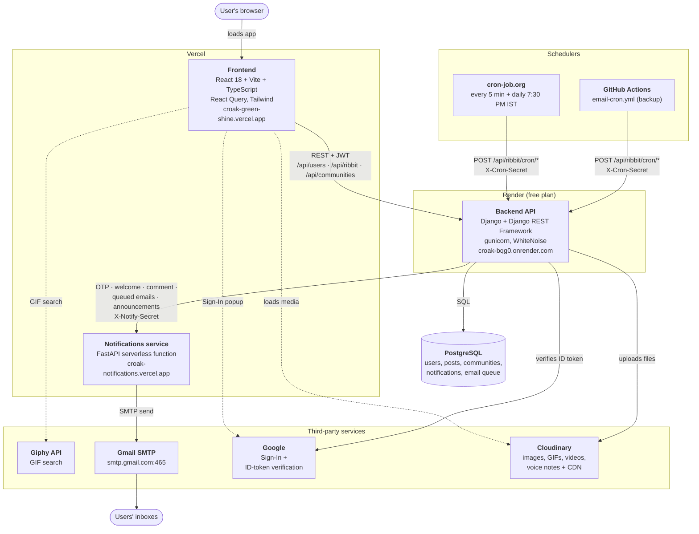
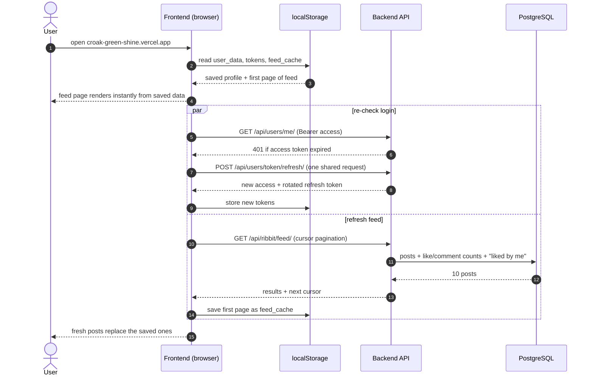
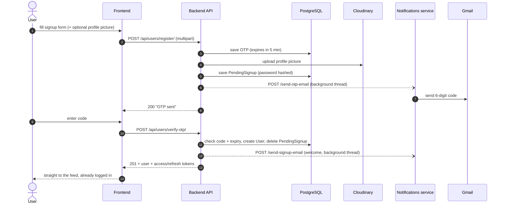
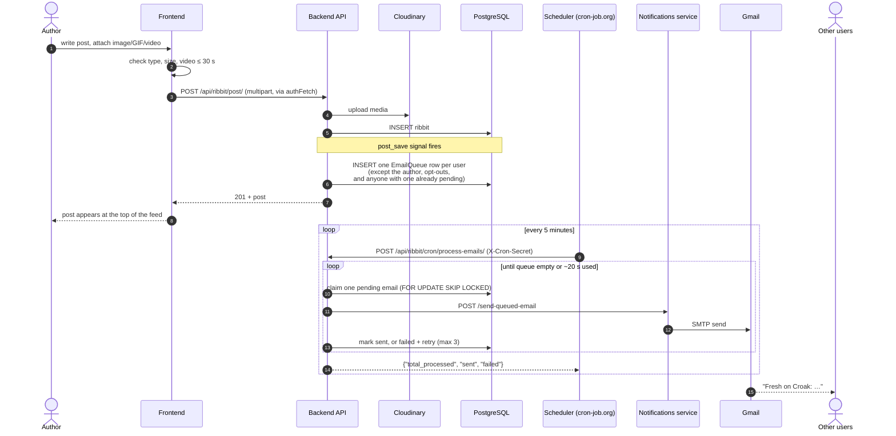
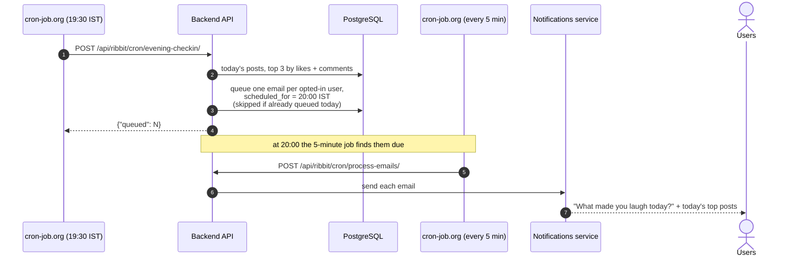
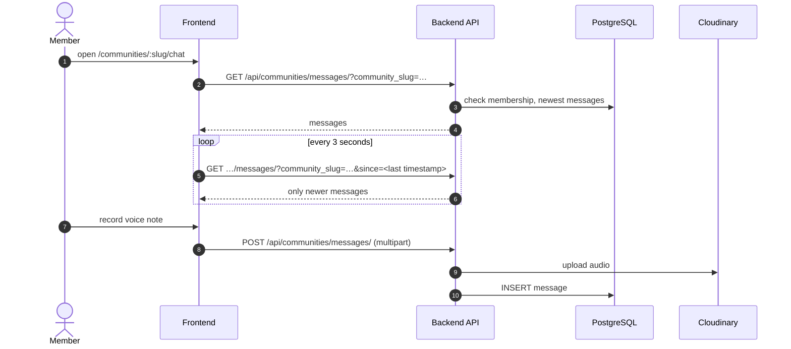
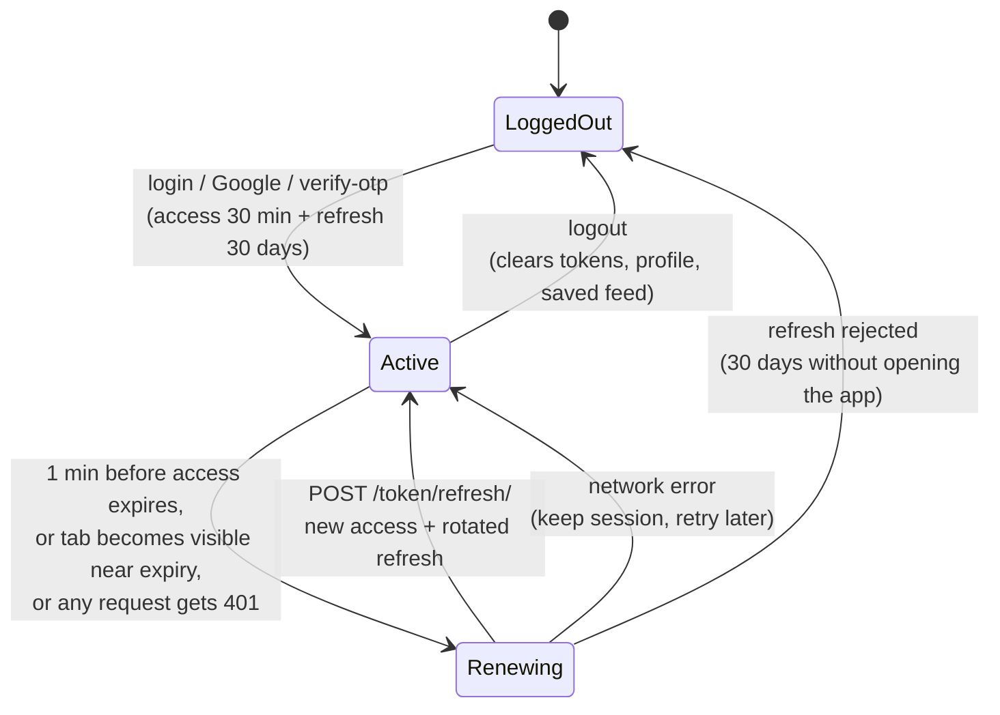
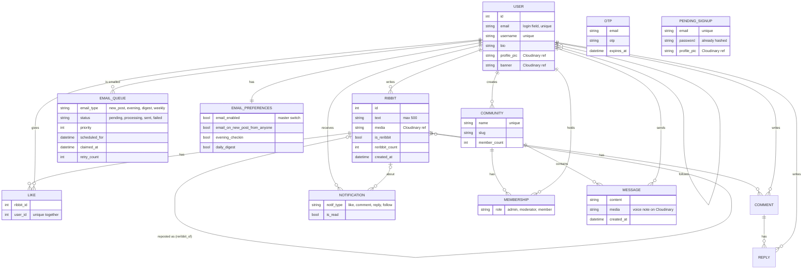
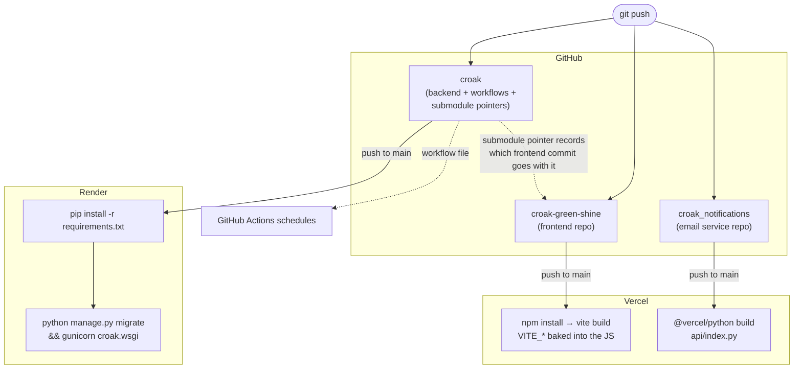

# Croak

A social platform for posts, follows and community group chats: React on Vercel, a Django REST API on Render, media on Cloudinary, and email sent by a small notifications service through scheduled jobs.

**Live:** [croak-green-shine.vercel.app](https://croak-green-shine.vercel.app)

This README is the map of how all the pieces fit together. Deeper details live next to the code:

| Part | Repo / folder | Details |
|---|---|---|
| Frontend (React) | [`croak-green-shine`](https://github.com/punitsinha23/croak-green-shine), mounted at `frontend/croak-green-shine` | Its own README |
| Backend (Django) | `backend/` in this repo | [`backend/README.md`](backend/README.md): API reference, design tradeoffs |
| Notifications service (FastAPI) | [`croak_notifications`](https://github.com/punitsinha23/croak_notifications), mounted at `croak_notifications/croak_notifications` | `api/index.py` |
| Scheduled jobs | `.github/workflows/email-cron.yml` and cron-job.org | [Schedulers](#5-scheduled-jobs-github-actions-and-cron-joborg) below |

---

## Contents

1. [System diagram](#1-system-diagram)
2. [Repository layout](#2-repository-layout)
3. [What each piece does](#3-what-each-piece-does)
4. [How requests flow](#4-how-requests-flow)
   - [Opening the app](#41-opening-the-app-signed-in)
   - [Signing up](#42-signing-up-with-an-email-code)
   - [Posting, and the new-post email](#43-posting-and-the-new-post-email)
   - [The 8 PM check-in](#44-the-8-pm-check-in)
   - [Community chat](#45-community-chat)
   - [Login tokens](#46-login-tokens)
5. [Scheduled jobs: GitHub Actions and cron-job.org](#5-scheduled-jobs-github-actions-and-cron-joborg)
6. [Data model](#6-data-model)
7. [Deployment pipeline](#7-deployment-pipeline)
8. [Configuration: which secret lives where](#8-configuration-which-secret-lives-where)
9. [Running everything locally](#9-running-everything-locally)
10. [Known risks](#10-known-risks)

---

## 1. System diagram



Solid arrows are calls between our own services; dotted arrows are the browser calling a third party directly.

**In one sentence each:**
- **The browser** only ever talks to Vercel (to load the app) and then to the APIs. Everything users see is the React app.
- **The backend** is the single source of truth: every post, like, follow and message goes through it into PostgreSQL.
- **Cloudinary** stores every uploaded file. The database keeps only a reference, and the browser loads the file straight from Cloudinary's CDN.
- **The notifications service** is the only thing that sends email. It turns a JSON request into an email and sends it from a Gmail account. Only the backend may call it: every request must carry the `X-Notify-Secret` header.
- **The schedulers** are alarm clocks: the backend never wakes itself up, so they call it on a timer to send queued email and the 8 PM check-in.

---

## 2. Repository layout

`croak` (this repo) is the hub. The frontend and the notifications service are separate repos linked in as **git submodules**, so each deploys on its own.

```text
croak/
├── .github/workflows/
│   └── email-cron.yml          # GitHub Actions schedule (backup scheduler)
├── backend/                    # Django project → deployed to Render
│   ├── croak/                  # settings, root URLs (/admin, /api/*, /api/health)
│   ├── users/                  # accounts, OTP signup, login, Google, follows
│   ├── ribbits/                # posts, likes, comments, reposts, notifications,
│   │                           # email queue, email templates, cron endpoints
│   ├── communities/            # communities, memberships, chat messages
│   └── README.md               # API reference + design tradeoffs
├── frontend/
│   └── croak-green-shine/      # submodule → React app → deployed to Vercel
└── croak_notifications/
    └── croak_notifications/    # submodule → FastAPI email service → deployed to Vercel
```

After cloning, fetch the submodules with:

```bash
git clone https://github.com/punitsinha23/croak.git
cd croak
git submodule update --init --recursive
```

---

## 3. What each piece does

| Piece | Tech | Hosted on | Responsible for |
|---|---|---|---|
| **Frontend** | React 18, Vite, TypeScript, Tailwind, shadcn/ui, React Query, React Router | Vercel | All UI. Keeps the login tokens and the first page of the feed in `localStorage` so a returning user sees the feed instantly. Renews the access token a minute before it expires |
| **Backend API** | Django 5, Django REST Framework, SimpleJWT, gunicorn, WhiteNoise | Render | Auth, posts, feed, likes, comments, reposts, follows, search, in-app notifications, communities and chat, the email queue, and the cron endpoints |
| **PostgreSQL** | Postgres via `DATABASE_URL` | Managed database | All persistent data, including the email queue itself |
| **Cloudinary** | `django-cloudinary-storage` | Cloudinary | Stores profile pictures, banners, post media, community icons and chat voice notes; serves them over its CDN with on-the-fly resizing (`w_…,q_auto,f_auto`) |
| **Notifications service** | FastAPI on Vercel's Python runtime | Vercel | Receives "send this email" requests from the backend (checked against `NOTIFICATIONS_SECRET`) and sends them over Gmail SMTP. Endpoints: `/send-otp-email`, `/send-queued-email`, `/send-bulk`, `/send-signup-email`, `/send-comment-email`, `/send-like-email`, `/send-follow-email`, `/send-new-post-notification` |
| **Gmail SMTP** | `smtp.gmail.com:465` | Google | The actual outgoing mail server |
| **cron-job.org** | HTTP scheduler | cron-job.org | Calls `process-emails` every 5 minutes (which also keeps Render awake) and `evening-checkin` daily at 19:30 IST |
| **GitHub Actions** | `email-cron.yml` | GitHub | Backup scheduler for the same endpoints. GitHub delays or skips frequent schedules on quiet repos, so it isn't relied on alone |
| **Google** | Google Identity Services + `google-auth` | Google | "Sign in with Google": the frontend gets an ID token and the backend verifies it |
| **Giphy** | Giphy REST API | Giphy | GIF search in the post composer and chat |

---

## 4. How requests flow

### 4.1 Opening the app (signed in)

The app shows saved data immediately and refreshes it in the background, so a sleeping Render server doesn't leave people staring at a spinner.



On the landing, login and signup pages the frontend also calls `GET /api/health/`, which doesn't touch the database, so Render starts booting while the user is still typing.

### 4.2 Signing up with an email code



"Sign in with Google" skips the code: the browser gets an ID token from Google, `POST /api/users/google/` verifies it with `google-auth`, finds or creates the user, and returns tokens.

### 4.3 Posting, and the new-post email

Email never happens inside the request. The post is saved, the emails go into a queue table, and a scheduler drains the queue.



Likes, comments and replies create **in-app** notifications (rows in `Notification`), which the bell icon reads from `GET /api/ribbit/notifications/`. A comment also emails the post's author straight away (`/send-comment-email`, in a background thread) unless they turned comment emails off.

### 4.4 The 8 PM check-in



### 4.5 Community chat

Chat uses short polling instead of WebSockets, which keeps the backend a plain HTTP app that fits Render's free plan.



### 4.6 Login tokens



---

## 5. Scheduled jobs: GitHub Actions and cron-job.org

The backend only does work when it receives a request, so timed work is triggered from outside. Every cron endpoint requires the `X-Cron-Secret` header to match the backend's `CRON_SECRET`.

| Endpoint (`POST /api/ribbit/cron/…`) | What it does | cron-job.org | GitHub Actions (backup) |
|---|---|---|---|
| `process-emails/` | Sends due emails from the queue, about 20 seconds' worth per call | every 5 min | `*/5 * * * *` |
| `evening-checkin/` | Queues the 8 PM check-in for every opted-in user | daily 19:30 Asia/Kolkata | `0 14 * * *` (UTC) |
| `daily-digest/` | Queues the activity digest or a "you're missing out" reminder | – | `0 9 * * *` (UTC) |
| `weekly-nudges/` | Queues "post something" reminders and suggested follows | – | `0 10 * * 1` (UTC) |
| `clear-pending/` | Deletes all unsent queued emails (manual cleanup) | – | – |
| `stats/` (GET) | Pending / failed / sent-today counts | – | – |

Why two schedulers? GitHub delays and drops frequent schedules on low-traffic repos (the 5-minute job was observed running only a few times a day). cron-job.org runs on time and, by pinging every 5 minutes, keeps the free Render instance from sleeping. Running both is safe: each email is claimed with `SELECT … FOR UPDATE SKIP LOCKED` before sending, so two runs can never send the same email.

---

## 6. Data model



`OTP` and `PENDING_SIGNUP` are keyed by email rather than linked to a user, because they exist before the account does.

---

## 7. Deployment pipeline



When the frontend changes, commit and push in `frontend/croak-green-shine` first, then commit the updated submodule pointer in `croak`, so the hub always points at a frontend commit that exists on GitHub.

---

## 8. Configuration: which secret lives where

Never put a backend secret in a `VITE_*` variable: those are compiled into the JavaScript every visitor downloads.

| Variable | Render (backend) | Vercel (frontend) | Vercel (notifications) | GitHub secrets | cron-job.org |
|---|:-:|:-:|:-:|:-:|:-:|
| `SECRET_KEY` | ✔ | | | | |
| `DEBUG` (unset in production) | ✔ | | | | |
| `DATABASE_URL` | ✔ | | | | |
| `CLOUDINARY_CLOUD_NAME` / `_API_KEY` / `_API_SECRET` | ✔ | | | | |
| `GOOGLE_CLIENT_ID` | ✔ | `VITE_GOOGLE_CLIENT_ID` | | | |
| `NOTIFICATIONS_SERVICE_URL` | ✔ | | | | |
| `NOTIFICATIONS_SECRET` | ✔ | | ✔ | | |
| `CRON_SECRET` | ✔ | | | ✔ | `X-Cron-Secret` header |
| `BACKEND_URL` (`https://croak-bqg0.onrender.com`) | | | | ✔ | (in the job URL) |
| `VITE_MODE` (`production`) | | ✔ | | | |
| `VITE_PROD_URL` (`https://croak-bqg0.onrender.com/api/`) | | ✔ | | | |
| `VITE_GIPHY_API_KEY` | | ✔ | | | |
| `EMAIL` / `PASSWORD` (Gmail + app password) | | | ✔ | | |
| `SENDER_NAME` (optional, default `Croak`) | | | ✔ | | |

The notifications repo has a `.env.example` listing its three variables; the real `.env` is git-ignored.

---

## 9. Running everything locally

```bash
# 1. Backend → http://127.0.0.1:8000
cd backend
python -m venv .venv && source .venv/bin/activate
pip install -r requirements.txt
cat > .env <<'EOF'
DEBUG=true
DATABASE_URL=sqlite:///db.sqlite3
EOF
python manage.py migrate
python manage.py runserver

# 2. Frontend → http://localhost:8080
cd frontend/croak-green-shine
npm install
echo 'VITE_MODE=development
VITE_DEV_URL=http://127.0.0.1:8000/api/' > .env.local
npm run dev

# 3. Send queued emails by hand instead of waiting for a scheduler
cd backend && python manage.py process_email_queue
```

Media uploads need the Cloudinary variables, and real email needs the notifications service. Everything else works with just the two variables above.

Tests:

```bash
cd backend && python manage.py test                 # Django
cd frontend/croak-green-shine && npm test           # Vitest + React Testing Library
```

---

## 10. Known risks

- **Gmail is the mail server.** Personal Gmail accounts are limited to roughly 500 recipients a day, and the new-post email goes to every user. A transactional email provider (Resend, Postmark, Amazon SES) and a domain sender address are the next step before real traffic.
- **Render's free plan sleeps** after 15 minutes without traffic, and the first request then takes 30–60 seconds. The 5-minute cron job keeps it awake in practice.
- **Media is uploaded to Cloudinary twice per post.** The first upload only checks the video length, then is deleted. The frontend now checks length before uploading, so the backend could skip this for images.

See [`backend/README.md`](backend/README.md#known-issues-and-next-steps) for the backend's own list.
